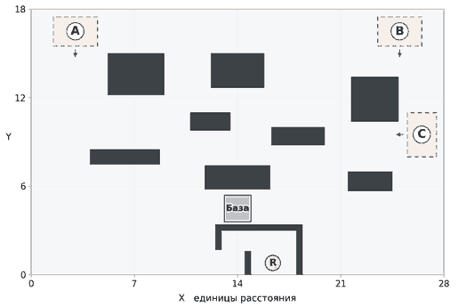

# Прототип игры про танк на магнитной доске

Prototype Design Document

Версия 0.5 12 ноября 2026

## 1 Назначение и состав прототипа

Игрок управляет игрушечным танком и защищает базу. Уничтоженные средние и тяжёлые противники оставляют неподвижные корпуса. Эти корпуса меняют маршруты, закрывают огонь и служат ресурсом для подготовки к следующей волне. Игрок выбирает место уничтожения противника, а затем решает, как использовать результат боя.

Прототип должен показать, получается ли намеренно создавать полезную оборону во время стрельбы и остаётся ли выбор между сохранением корпуса и его разбором интересным на протяжении попытки. Разделы 1–13 описывают актуальные правила и отдельно отмеченный объём расширения. Проверки приведены в разделе 14; запланированная серия ручных плейтестов ещё не проведена.

### Что проверяем

- Игрок способен выбрать область уничтожения врага и повторить результат под умеренным давлением.

- Полезность корпуса зависит от его положения, следующей атаки и состояния базы. В разных ситуациях оправданы разные способы его использования.

- Баррикады меняют действия в бою и дают преимущество, но сохраняют необходимость двигаться, выбирать цели и стрелять.

- К последним волнам подготовка сохраняет смысл. Успешная игра может оставлять запас ресурсов.

### Целевой объём первой версии

Одна карта, один танк игрока, три типа противников, два пассивных модуля, один слот модуля и восемь заданных волн. Попытка заканчивается победой после последней атаки или поражением при уничтожении базы. Начальная цель по длительности — около 8–12 минут с подготовкой; это ориентир для замеров, а не ограничение времени игрока.

В прототип не входят стреляющие сооружения, перенос корпусов, склад, золото, дополнительные способности, случайная добыча, постоянные улучшения между попытками, процедурные карты и интеграция со Steam. Управление — клавиатура и мышь на ПК, камера сверху показывает всё поле.

### Статус решений

В прототипе выбраны свободное движение с независимым прицеливанием, фиксированное расписание волн, восстановление танка между волнами и описанные ниже правила ИИ. Все числа задают начальную конфигурацию. Их меняют по результатам проверки, отдельно от изменений правил. Указанные в документе игровые преимущества нужно подтвердить в работающем прототипе.

Текущий прототип 05 на JavaScript и Canvas содержит восемь волн на карте с тремя входами. Лёгкие преследуют игрока, средние и тяжёлые атакуют базу и оставляют корпуса вне зон появления. Доступны ремонт базы за корпус, пассивные модули, укрепление корпусов и общая отмена операций подготовки. Действующее расписание приведено в разделе 8, результаты исходной четырёхволновой сборки — в подразделе 14.5.

## 2 Ход попытки

### Начальное состояние

База и танк имеют полную прочность. Корпусов на поле нет, слот модуля пуст. Игрок начинает в нише возрождения у базы. Первая фаза — подготовка к волне 1. Новая попытка полностью восстанавливает это состояние и то же расписание врагов.

### Подготовка

Врагов и снарядов на поле нет. Игрок осматривает следующую волну, распоряжается корпусами и перемещается по доступной части карты без таймера. Стены, корпуса и зоны появления врагов ограничивают движение. Стрельба отключена, корпуса нельзя толкать. Кнопка «Начать волну» фиксирует решения и текущую позицию танка.

В подготовке танк считается полностью исправным. При смене модуля его прочность сразу соответствует новому максимуму. База автоматически не восстанавливается. Сроки и прочность корпусов во время подготовки не изменяются сами по себе.

### Бой

После запуска начинается расписание появления врагов. Игрок двигается, целится и стреляет. Разбор, укрепление и смена модуля недоступны. Новый корпус сразу становится препятствием и может повлиять на оставшуюся часть текущей волны.

### Завершение волны

1. Когда все запланированные враги появились и были уничтожены, начинается завершение волны. Новые выстрелы запрещены; движение и полёт выпущенных снарядов продолжаются. Сроки корпусов списываются только после исчезновения всех снарядов.
2. При нулевой прочности базы попытка немедленно заканчивается поражением. Это правило имеет приоритет над завершением волны и победой.
3. У уцелевших корпусов, существовавших на старте завершённой волны, срок уменьшается на один. Корпуса, созданные в этой волне, срок не теряют.
4. Корпуса с нулевым сроком удаляются. После последней волны объявляется победа. Иначе начинается следующая подготовка и создаётся её исходное состояние для отмены действий.

### Гибель и возвращение танка

При нулевой прочности танк исчезает и возвращается через 4 секунды с полной прочностью и прежним модулем. Враги продолжают атаковать. Танк игрока не оставляет пригодного корпуса. Если волна заканчивается раньше возвращения, танк появляется в нише сразу при начале подготовки.

Ниша у базы защищает точку возвращения от прямого внешнего обстрела неразрушаемыми стенами и не лежит на обычных маршрутах к базе. Отдельной неуязвимости после появления нет; действуют обычные правила боя. Если корпус перекрыл выход, его можно расстрелять. Ниша не лечит танк, а база во время возвращения остаётся уязвимой.

## 3 Танк игрока и стрельба

### Управление

| Ввод | Действие |
| --- | --- |
| WASD | Движение относительно экрана. Диагональная скорость нормализована. |
| Мышь | Независимое прицеливание башни на 360 градусов. |
| ЛКМ в бою | Выстрел при нажатии; повторная стрельба при удержании. Общий интервал — 0,30 секунды. |
| ЛКМ в подготовке | Выбор корпуса, действия и цели укрепления. |
| Ctrl Z | Отмена последней операции подготовки. |
| Esc | Пауза с продолжением и перезапуском попытки; при выборе цели укрепления — выход из выбора. |

Движение начинается и прекращается без инерции. Визуальный поворот корпуса не задерживает ввод. Танк не проталкивает другие танки или корпуса. Пауза останавливает бой, но не открывает действия подготовки.

### Начальные параметры

Единица расстояния равна диаметру коллизионного контура танка. В первом билде все танки имеют круглый контур диаметром 1 единица. Контур уничтоженного танка и его корпуса совпадает.

| Параметр | Значение | Единица |
| --- | --- | --- |
| Прочность танка | 60 | HP |
| Скорость движения | 4 | единицы в секунду |
| Урон выстрела | 20 | HP |
| Интервал выстрелов | 0,30 | секунды |
| Скорость снаряда | 40 | единиц в секунду |
| Дальность выстрела | 6 | единиц |
| Прочность базы | 240 | HP |

### Попадания

Снаряд считается точкой. Он появляется в центре стрелка, игнорирует породивший его танк и летит по прямой. Дальность отсчитывается от места появления. Быстрый снаряд не должен пролетать сквозь препятствия. Он исчезает при первом столкновении или на пределе дальности. Контакт на пределе дальности считается попаданием. Визуальный вылет из дула на расчёт не влияет.

Игрок стреляет из центра танка через положение курсора в момент выстрела. Курсор в самом центре танка не задаёт направление, поэтому выстрел не происходит. Частые нажатия не обходят интервал 0,30 секунды. Рикошетов, пробития, взрывного урона и разброса нет. Стены поглощают снаряды; корпуса получают полный урон от обеих сторон.

Выстрелы повреждают живых противников. Попадание по живому союзному танку или собственной базе поглощает снаряд без урона. Уничтожающий выстрел расходуется на танк и не повреждает появившийся корпус повторно. Другие снаряды могут повредить этот корпус сразу после его появления.

## 4 Противники и выбор маршрута

| Параметр | Лёгкий | Средний | Тяжёлый |
| --- | --- | --- | --- |
| Прочность | 20 HP | 60 HP | 120 HP |
| Скорость | 2,6 ед/с | 1,7 ед/с | 1,1 ед/с |
| Урон | 8 HP | 12 HP | 20 HP |
| Интервал огня | 1,4 с | 1,2 с | 2,0 с |
| Дальность | 6 ед | 5 ед | 6 ед |
| После гибели | Исчезает | Средний корпус | Тяжёлый корпус |

Лёгкий отвлекает и преследует игрока. Средний предпочитает базу и оставляет корпус. Тяжёлый медленнее, прочнее и наносит больше урона за попадание.

### Выбор пути

1. Враг строит путь к доступной точке контакта с контуром базы. Учитываются радиус танка и неподвижные стены; живые танки в глобальный поиск не входят.
2. Если есть дорога без разрушения корпусов, выбирается кратчайшая. Даже повреждённый корпус не атакуется ради сокращения пути.
3. При полной блокировке сравниваются число разных корпусов для разрушения, затем длина пути по сетке с шагом 0,25 с учётом отрезков от текущей позиции и до базы. Повторное пересечение одного корпуса учитывается один раз. Сглаживание сохраняет набор корпусов. Первый корпус на сглаженном маршруте становится целью пролома.
4. Путь пересчитывается при появлении или удалении корпуса; равноценный выбор стабилен. Живые танки временно ожидают или объезжают друг друга, не меняя цель пролома.

### Выбор цели и точки прицеливания

Средний выбирает базу, затем назначенный корпус для пролома, затем игрока. Лёгкий предпочитает видимого игрока в дальности огня. В погоне он сближается с игроком или последней видимой точкой, не переключаясь на базу. Вне погони при недоступном игроке порядок обычный. Произвольные корпуса не атакуются.

По танку или корпусу враг целится в центр. Дальность проверяется до первой границы цели на этом луче. По базе он выбирает ближайшую видимую точку её внешнего контура в пределах дальности. При равных расстояниях выбирается меньшая координата X, затем большая Y в системе координат документа. Видимая часть базы позволяет стрелять, даже если её центр скрыт стеной.

По базе и назначенному корпусу враг стреляет с остановки, по игроку — и в движении. Цель доступна, если снаряд в пределах дальности первым столкнётся с ней. Стены, корпуса и союзники закрывают огонь.

Лёгкий замечает открытого игрока в радиусе 7 между центрами. Погоня длится до 3 с в пределах 4 единиц от места её начала; сближение — до дистанции 2. Потеряв видимость, лёгкий до 0,8 с идёт к последней увиденной точке, не отслеживая скрытого игрока.

Гибель игрока, истечение ограничений или блокировка на 0,4 с завершают погоню. Путь к базе строится от текущей позиции; новая погоня возможна через 2 с. Скорость и столкновения обычные.

### Выстрел и перезарядка

Враг с готовым оружием сразу стреляет из своего центра в выбранную точку доступной цели. Подготовка на 0,35 с и предупреждение убраны. Снаряд летит по прямой со скоростью 10 единиц в секунду, не отслеживая цель.

Между выстрелами проходит 1,4 с у лёгкого, 1,2 с у среднего и 2 с у тяжёлого. Без доступной цели готовое оружие ждёт без расхода перезарядки. Движение цели не отменяет выстрел. Союзник поглощает попадание без урона.

Предпросмотр показывает геометрический путь к базе или первому корпусу для пролома, без погони, остановок для огня и временных заторов.

### Роль тяжёлого танка в целевой версии

Владелец утвердил эту роль 13 ноября 2026 года для [#2](https://github.com/AidarKhusainov/tanks-for-the-cover/issues/2). Тяжёлый — медленный противник с приоритетом базы. Для его уничтожения нужно шесть обычных попаданий игрока, для среднего — три. Тяжёлый может открыть огонь с большей дистанции. Это даёт игроку время выбрать место уничтожения, но оставлять тяжёлого на открытой линии к базе рискованно. Тяжёлый и средний наносят одинаковые номинальные 10 HP/с при непрерывных попаданиях, у тяжёлого больше урон одного попадания. После уничтожения вне зоны появления тяжёлый даёт баррикаду, которую можно использовать в двух следующих боях или разобрать на броню либо ремонт (§§5–6).

- Тяжёлый использует известное положение базы, геометрию карты и расположение корпусов для общего поиска пути. Живые танки учитываются в локальном движении и перекрывают выстрелы. Открытого живого игрока тяжёлый видит только по доступному лучу в пределах дальности огня. Погони, памяти о последнем положении и реакции на скрытого игрока нет.
- На каждом шаге приоритет доступных целей такой — видимая точка контура базы, первый назначенный корпус для пролома, игрок. Доступность и точка прицеливания определяются по общим правилам выше. Тяжёлый обходит корпуса, пока существует свободный путь. При полной блокировке цель пролома задаёт общий выбор пути, урон тяжёлого не меняет критерий маршрута.
- Пока выбрана база или назначенный корпус, танк стоит, в том числе при перезарядке. При потере такой цели он продолжает движение по маршруту, если нет обычного затора. По игроку он может стрелять на ходу, сохраняя маршрут к базе. Произвольные корпуса не выбираются целями, но могут перехватить уже выпущенный снаряд.
- Начальные параметры берутся из таблицы §4. Готовое оружие стреляет сразу, снаряд летит по прямой со скоростью 10 ед/с. При отсутствии доступной цели перезарядка не расходуется.

При проверке #6 дать тяжёлому одновременно доступ к базе и игроку, затем закрыть луч к базе при доступном назначенном корпусе. Он должен переключиться на пролом. При доступном обходе и видимом игроке тяжёлый продолжает движение и стреляет по игроку с готовым оружием. После потери игрока за стеной тяжёлый продолжает путь без погони. Отдельно проверить остановку при перезарядке и возобновление движения после потери доступной стационарной цели.

## 5 Появление и срок службы корпусов

Лёгкий танк исчезает без ресурса. Средний и тяжёлый при уничтожении создают корпус в той же позиции и с тем же коллизионным контуром. Позиция не округляется до клетки. Корпус не сдвигает соседние объекты, блокирует движение и обычные снаряды обеих сторон.

| Параметр | Средний корпус | Тяжёлый корпус |
| --- | --- | --- |
| Начальная и максимальная прочность | 60 HP | 120 HP |
| Срок после появления | 1 следующая волна | 2 следующие волны |
| Восстановление укреплением | 30 HP | 60 HP |
| Максимальное продление | 1 волна один раз | 1 волна один раз |

Начальная прочность корпуса не зависит от последнего попадания по танку. При нулевой прочности корпус исчезает и ресурс теряется. Между волнами автоматического уменьшения прочности нет. Срок службы и прочность — независимые ограничения.

### Как считается срок

Волна появления не расходует срок, хотя корпус уже работает в бою. Каждая последующая завершённая волна расходует одну единицу. При нуле корпус исчезает до следующей подготовки. Обычный средний корпус можно либо разобрать перед следующей волной, либо оставить для этой волны; после неё разобрать его уже нельзя.

Каждая строка таблицы — отдельный вариант судьбы корпуса, созданного в волне 2 и не разрушенного огнём. Для укрепления предполагается отдельный пригодный донор. Числа показывают оставшиеся волны службы перед запуском указанной волны, после описанного действия подготовки.

| Корпус | К волне 3 | К волне 4 | К волне 5 | К волне 6 |
| --- | --- | --- | --- | --- |
| Средний без укрепления | 1 | Удалён | Удалён | Удалён |
| Тяжёлый без укрепления | 2 | 1 | Удалён | Удалён |
| Средний укреплён перед волной 3 | 2 | 1 | Удалён | Удалён |
| Тяжёлый укреплён перед волной 4 | 2 | 2 | 1 | Удалён |

### Границы магнитного поля

Зоны появления врагов находятся вне удерживающего поля. Если центр танка в момент гибели лежит внутри такой зоны или на её границе, пригодный корпус не создаётся. Декоративные обломки быстро исчезают и не имеют коллизии. В остальных местах корпус появляется по общему правилу.

Границы зон видны постоянно. Перечёркнутый значок корпуса для врага внутри зоны остаётся целевой подсказкой. Танк игрока не может пересекать зону своим контуром ни в подготовке, ни в бою. Это ограничение движения не блокирует снаряды. Враги свободно выходят из зоны. Если место появления занято ранее появившимся врагом, следующий ждёт в очереди; очередь считается частью незавершённой волны.

## 6 Действия подготовки и экономика

Пригоден любой существующий корпус с положительной прочностью и сроком службы. Он даёт ровно один результат при разборе. Расстояние до танка игрока не ограничивает действия подготовки. Отдельного запаса материалов или запасных модулей нет.

В текущем прототипе доступны сохранение корпуса, разбор на ремонт базы или модуль, укрепление за счёт другого корпуса и общая отмена.

Двигатель повышает скорость до 5 единиц в секунду (+25%). Броня увеличивает максимальную прочность до 90 HP (+50%) без изменения скорости. Модули не меняют оружие.

| Действие | Результат | Условие и расход |
| --- | --- | --- |
| Оставить | Корпус участвует в следующем бою | Ничего не расходуется. Будущий разбор доступен, пока корпус существует. |
| Взять модуль | Средний даёт двигатель, тяжёлый даёт броню | Выбранный корпус исчезает. Прежний модуль заменяется без возврата. |
| Ремонт базы | Средний восстанавливает 30 HP, тяжёлый 50 HP | Выбранный корпус исчезает. Ремонт ограничен максимумом базы. |
| Укрепить | Цель восстанавливает 50% своей максимальной прочности и получает ещё одну волну | Выбранный донор исчезает. Цель должна быть другим корпусом, который ещё не укрепляли. |

Укрепление не увеличивает максимальную прочность. Например, тяжёлый корпус с 30 HP после укрепления получает 90 HP, а со 100 HP — 120 HP. Укреплять целый корпус можно ради срока. Повторное укрепление того же корпуса недоступно, включая повторный ремонт этим действием.

Средний и тяжёлый доноры одинаково укрепляют одну и ту же цель. Текущая прочность донора не влияет на результат. Укреплённый корпус тоже можно разобрать; он даёт обычный результат своего типа. Накопленный срок и признак укрепления донора к получателю не переходят.

### Недоступные и частично полезные действия

Разбор на ремонт разрешён и при полной базе, чтобы игрок мог расчистить проход. До подтверждения показано фактическое восстановление, в том числе «0 HP, корпус будет разобран». Установка уже установленного типа модуля отключена. Отдельно снять модуль или получить за него ресурс нельзя. Укрепление по общему правилу восстанавливает прочность и добавляет одну волну срока. Если новый срок выходит за финал, интерфейс объясняет, что продление за пределы кампании пользы не принесёт.

### Отмена

Операции отменяются в обратном порядке в пределах текущей подготовки. Каждая отмена восстанавливает затронутые корпуса, модуль, прочность базы и позицию танка непосредственно перед этой операцией. Прочность танка соответствует восстановленному модулю. Это правило действует всегда, даже если возвращаемый корпус не пересекается с танком.

Например, игрок разобрал баррикаду, проехал через проход и отменил разбор. Баррикада вернётся, а танк окажется на прежней стороне. Само перемещение отдельной записи отмены не создаёт. Отмена всех операций возвращает их последствия к началу подготовки; истёкшие до неё корпуса не восстанавливаются.

После запуска волны история отмены очищается. Корпуса, уничтоженные в бою или исчезнувшие по сроку до подготовки, вернуть нельзя. Новый бой начинается с полной прочности танка, рассчитанного по окончательно выбранному модулю.

## 7 Тестовая карта

Арена 28 × 18 показана целиком; начало координат — нижний левый угол. Отдельные руины и бетонные укрытия блокируют танки и снаряды, оставляя несколько обходов. Дороги, следы и воронки декоративные и проходимы.

A, B и C — зоны появления врагов; стрелки показывают направления выхода. R — точка возвращения. Тёмные области — неразрушаемые укрытия. Границы зон появления ограничивают движение игрока, но пропускают снаряды.

| Объект | Положение |
| --- | --- |
| Входы A и B | A (3; 16,5), B (25; 16,5). Зоны 3 × 2 вокруг каждой точки; выход вниз. |
| Боковой вход C | C (26,5; 9,5). Зона 2 × 3; выход влево. Во всех зонах корпус не создаётся. |
| Руины | Слева сверху: X 5,2–9,0; Y 12,2–15,0. Сверху: X 12,2–15,8; Y 12,7–15,0. Справа сверху: X 21,7–24,9; Y 10,4–13,4. Над базой: X 11,8–16,2; Y 5,8–7,4. |
| Бетонные укрытия | В центре слева: X 10,8–13,5; Y 9,8–11,0. В центре справа: X 16,3–19,9; Y 8,8–10,0. Слева: X 4,0–8,7; Y 7,5–8,5. Справа снизу: X 21,5–24,5; Y 5,7–7,0. |
| База | Центр (14; 4,5), контур 1,8 × 1,8 единицы. |
| Ниша R | R (16,4; 0,8). Верх: X 12,5–18,4; Y 3,0–3,4. Справа: X 18,0–18,4; Y 0–3,4. Слева: X 12,5–12,9; Y 1,7–3,4. Перегородка: X 14,5–14,9; Y 0–1,6. |

Раздельные укрытия позволяют перехватывать разные группы и разрывать линию огня. Игрок заранее выбирает позицию и путь отхода. Полезность корпуса у обходов проверяется в бою; один корпус не обязан полностью закрывать направление.

Без корпусов из каждого входа A/B/C должен существовать путь к базе. Проверяются свободный обход, пролом при полной блокировке и выход из ниши. Танк в R защищён от прямого внешнего огня. Выгодные неподвижные позиции проверяются по разделу 10.

## 8 Расписание волн

Расписание фиксировано. Л — лёгкий, С — средний, Т — тяжёлый танк. В записи «0 A Л Л С» первый танк появляется в точке A на нулевой секунде, следующие — каждые 2,5 секунды в указанном порядке. Разные пакеты идут параллельно. Для каждой точки действует одна очередь: враг появляется не раньше своего планового времени и не раньше чем через 2,5 секунды после предыдущего фактического появления в этой точке. Если весь контур танка не помещается без пересечения, появление откладывается. Задержка не ускоряет выпуск очереди.

### Исходные четыре волны

Прототип 05 до подключения кампании использовал следующие группы. Всего 23 танка: 14 лёгких и 9 средних. Вход C включается со второй волны; в третьей и четвёртой задействованы все три направления.

| Волна | Группы появления | Всего |
| --- | --- | --- |
| 1 | 0 A Л С; 5 B Л Л | 4 |
| 2 | 0 B С Л Л; 4 C Л С | 5 |
| 3 | 0 A С Л; 2 B Л С; 6 C Л Л | 6 |
| 4 | 0 A С Л С; 1 B Л С Л; 4 C Л С | 8 |

### Информация о следующей атаке

В подготовке показаны номер ближайшей волны, порядок танков по входам A/B/C и время начала каждой группы. Кнопка «Кампания» открывает сводку всех восьми волн и отмечает восьмую волну как финал.

План ближайшей атаки помогает решить, какие корпуса оставить и откуда встречать врагов. Расписание повторяется после перезапуска. Скрытой случайности и масштабирования сложности по состоянию базы в текущем билде нет.

### Как менять расписание

Сначала проверяется, успевает ли игрок осмысленно выбирать точку уничтожения. Если бой слишком прост, меняется один фактор: интервал появления, число лёгких или смещение пакета с одного из флангов. Добавление средних и тяжёлых одновременно меняет приток ресурсов, поэтому его последствия проверяются и в следующих подготовках.

### Прежний вариант расширения до восьми волн

Таблица ниже сохраняет исходный вариант для карты с двумя входами. Для реализации на карте A/B/C используется утверждённое расписание из следующего подраздела.

| № | Пакеты появления | Назначение волны |
| --- | --- | --- |
| 1 | 0 A Л Л С Л | Познакомить с движением, стрельбой и первым средним корпусом. |
| 2 | 0 B Л С Л Л 8 A Т | Дать первый тяжёлый корпус и проверить перенос внимания между сторонами. |
| 3 | 0 A С Л Л 4 B Л Л С | Проверить двигатель, выбор фланга и последствия первого расходования корпусов. |
| 4 | 0 B Т Л С Л 6 A Л Л Л | Проверить сохранение тяжёлого корпуса, срок и полезность укрепления. |
| 5 | 0 A Т Л Л С 0 B Л С Л Л | Создать одновременное давление и проверить выбранные проходы. |
| 6 | 0 A Л Л Л С Л 3 B Т Л Л С Л | Увеличить боевую нагрузку преимущественно лёгкими врагами. |
| 7 | 0 B Т Л С Л Л 5 A Л Л С Л Л | Проверить перестройку обороны перед известной финальной атакой. |
| 8 | 0 A Т Л С Л Л Л 0 B Т Л С Л Л Л 18 A Л Л 18 B Л Л | Проверить подготовленную оборону, действия на двух сторонах и восстановление после ошибки. |

### Утверждённые восемь волн для карты A/B/C

Владелец утвердил расписание 13 ноября 2026 года для [#2](https://github.com/AidarKhusainov/tanks-for-the-cover/issues/2). Первые три волны повторяют прототип 05. В четвёртой второй средний на A заменён тяжёлым. Это сохраняет общий старт и вводит первый тяжёлый корпус перед волной 5, когда остаётся время сравнить броню, сохранение и укрепление. Боковой C остаётся в ранних волнах с лёгкими и средними. Первый тяжёлый выходит из A, дальше тяжёлые появляются также на B и C. Близкий к базе C в финале запускается с задержкой, чтобы проверить наложение угроз с A. Моменты встречи и открытие огня зависят от путей, преград и действий игрока.

Действуют общие правила §8. Время указано в секундах от запуска каждой волны. Порядок букв внутри пакета задаёт порядок появления с плановым шагом 2,5 с. В этой таблице на каждом входе не более одного пакета за волну. Пакеты работают параллельно, задержка на одном входе не сдвигает другие. Занятое место откладывает появление без сокращения минимального интервала 2,5 с между фактическими появлениями на этом входе. Состав, порядок и плановое время фиксированы для каждой попытки независимо от HP, модуля и действий игрока.

| Волна | Пакеты появления | Л | С | Т | Всего | Какой выбор проверяем |
| --- | --- | ---: | ---: | ---: | ---: | --- |
| 1 | 0 A Л С; 5 B Л Л | 3 | 1 | 0 | 4 | Выбрать место первого среднего корпуса и решить, оставить ли его перед атакой с B/C, разобрать на двигатель или ремонт. |
| 2 | 0 B С Л Л; 4 C Л С | 3 | 2 | 0 | 5 | Сместиться между северо-восточным и боковым входами. Сравнить пользу двигателя и сохранённого корпуса, если они были доступны. |
| 3 | 0 A С Л; 2 B Л С; 6 C Л Л | 4 | 2 | 0 | 6 | Выбрать приоритет между тремя входами и проверить, меняет ли сохранённый корпус подход к бою. |
| 4 | 0 A С Л Т; 1 B Л С Л; 4 C Л С | 4 | 3 | 1 | 8 | Выбрать место уничтожения первого тяжёлого под давлением других групп. |
| 5 | 0 A Л С Л; 1 C Л С Л; 6 B Т Л | 5 | 2 | 1 | 8 | Проверить тяжёлую баррикаду с прошлой волны или броню, полученную её разбором. Поздний B проверяет смену позиции. |
| 6 | 0 A Л С Л; 0 B Л Л С; 5 C Л С Л Л | 7 | 3 | 0 | 10 | Выбрать, продлить ли полезную баррикаду за средний корпус. Больше лёгких даёт повод проверить мобильность двигателя и цену попаданий с бронёй. |
| 7 | 0 B Л Т Л С; 0 C Л Л С; 4 A С Л Л Т | 6 | 3 | 2 | 11 | Перестроить оборону с учётом того, сохранился ли первый тяжёлый корпус. Попробовать получить корпуса в местах, полезных против известного плана финала. |
| 8 | 0 A Т Л С Л Л; 2 B Л С Л Л; 5 C Т Л С Л Л | 9 | 3 | 2 | 14 | Проверить выбор позиции, ремонта и баррикад. Укрепление полезно восстановлением HP, если корпус повреждён и пригодится в финальном бою. |
| **Итого** | | **41** | **19** | **6** | **66** | |

#### Потенциальные корпуса в подготовке

В каждой волне потенциальное число новых средних и тяжёлых корпусов равно столбцам С и Т. Максимум за восемь боёв — 19 средних и 6 тяжёлых. Для подготовки успевают поступить максимум 16 средних и 4 тяжёлых из волн 1–7. Расчёт предполагает, что всех этих врагов уничтожили вне зон появления, а корпуса пережили бой. Корпуса финальной волны могут повлиять на её оставшийся бой.

| Перед волной | Новые С / Т | Т, сохранившиеся с позапрошлой волны | Всего без расхода и укрепления |
| --- | ---: | ---: | ---: |
| 1 | 0 / 0 | 0 | 0 |
| 2 | 1 / 0 | 0 | 1 |
| 3 | 2 / 0 | 0 | 2 |
| 4 | 2 / 0 | 0 | 2 |
| 5 | 3 / 1 | 0 | 4 |
| 6 | 2 / 1 | 1 | 4 |
| 7 | 3 / 0 | 1 | 4 |
| 8 | 3 / 2 | 0 | 5 |

Средний из волны 4 исчезает после 5 без укрепления. Тяжёлый из 4 работает в 5–6. Перед 6 его можно оставить на последний бой, разобрать или продлить до конца 7 за отдельного донора. Тяжёлый из 5 без укрепления исчезает после 7, так что перед финалом его может сохранить только продление, сделанное до истечения срока. Для корпуса из волны 7 срок уже покрывает финал. Укрепление расходует донора и лишь один раз продлевает срок цели на одну волну. Каждый сохранившийся корпус даёт игроку выбор по §6. При гибели врага в зоне, разрушении корпуса или его расходовании доступных корпусов будет меньше.

#### Условия проверки восьми волн

После интеграции зафиксировать сборку, карту, параметры, расписание, исходное состояние сцены и намеченную область в координатах §7. Для сравнения «раннее уничтожение или выбор места» использовать волну 4 с полной базой и танком без модуля, без корпусов. Зафиксировать одинаковую достижимую стартовую позицию и область на маршруте A вне зоны появления. Записать фактическое место корпуса, причину промаха, влияние на маршруты, потери базы и танка. Для сравнения сохранения, разбора на броню и укрепления использовать пары прогонов из одного состояния. Перед волной 5 сравнить «оставить тяжёлый корпус» и «разобрать тот же корпус на броню». Перед волной 6 сравнить «оставить цель и донора» и «укрепить ту же цель за счёт донора». Фиксировать позицию и остальные решения подготовки. Записать движение, HP, смерти и остаток полезных корпусов. Порядок повторов A/B и B/A по §11.

Для полного прогона начать новую попытку с первой подготовки. Засечь активное время от её начала до итогового экрана, включая все подготовки, бой и долёт последних снарядов. Отдельно записать время подготовки и боя по волнам, исключённые паузы и итог попытки. Ранние поражения учитывать отдельно при сопоставлении длительности успешных попыток с ориентиром 8–12 минут. Подготовка остаётся без таймера.

В предварительном браузерном прогоне [#4](https://github.com/AidarKhusainov/tanks-for-the-cover/issues/4) на четырёхволновом прототипе 05 машинное управление в Chrome сохранило 240 HP базы после первых трёх волн и 232 из 240 HP после четвёртой. В отдельной попытке без ответного огня первый вражеский выстрел зарегистрирован примерно на четвёртой секунде боя, а база пала в первой волне. В контрольной сцене снаряды игрока разрушили корпус перед врагом. Для #6 эту линию огня следует проверить с обоими типами корпусов.

Владелец принял [визуальный и PCM-прогон #4](browser-smoke.md) для исходной четырёхволновой сборки. В плейтесте #14 предстоит проверить, замечает ли игрок первый снаряд и появление корпуса, успевает ли отпустить огонь, слышит ли игровые сигналы и меняет ли сохранённый корпус следующий бой. В расширенной кампании проверить переход с A к B/C и снова наблюдать, успевает ли игрок заметить первый снаряд. Проходимость и полную длительность восьми волн проверяют в #13, сложность и ценность корпусов для человека — в #14.

## 9 Информация на экране

### Во время боя

Постоянно видны прочность базы и танка, номер волны и оставшиеся враги с учётом очереди появления. У противников показаны прочность и число попаданий до уничтожения. Под прочностью танка показан текущий модуль или пустой слот.

Предупреждения перед выстрелом нет. Знак «!» отмечает преследующего лёгкого, а не подготовку огня. Попадание, уничтожение танка, появление и разрушение корпуса различаются звуком и коротким эффектом. Эффекты не скрывают снаряды, прицел и границы укрытий.

Живой танк узнаётся по работающей башне и гусеницам. У корпуса башня неподвижна и повреждена; видна полоска прочности. Подпись «до N» указывает последнюю волну службы: для корпусов из волны 2 это «до 3» у среднего и «до 4» у тяжёлого. Подробности есть в карточке. Укреплённый корпус обозначен стрелкой ↑ рядом с типом и текстом в карточке.

### Во время подготовки

В текущем билде выбор корпуса открывает сохранение и разбор на ремонт базы или модуль. При выборе видны эффект модуля, замена текущего модуля и причина, если установка недоступна. Для укрепления выбери донора, нажми «Укрепить другой корпус», затем укажи цель на поле. Карточка показывает расход донора, итоговые HP и срок цели. Для применения нужно подтвердить расход; отмена выбора сохраняет оба корпуса. В карточке показаны тип, прочность и «Исчезнет после волны N»; перед последней волной службы это указано отдельно.

Наведение и клавиатурный фокус показывают на поле расходуемый корпус и цель, а в карточке — фактический ремонт, новый модуль или результат укрепления. Предпросмотр отмены отмечает возвращаемые и восстанавливаемые корпуса и позицию танка перед операцией. Недоступное действие сопровождается объяснением.

Прогноз позволяет выбрать один из входов A/B/C, все входы и тип противника. Для одинаковых препятствий геометрия пути общая для всех трёх типов. Свободная линия доходит до точки контакта с базой. Заблокированная линия заканчивается в точке контакта танка с первым корпусом, который отмечается кругом. Погоня, остановки для огня и временные заторы меняют фактическое движение.

Подпись прогноза: «Маршрут при текущих препятствиях». Новые и разрушенные корпуса могут изменить его во время боя. Интерфейс не обещает точного положения всех врагов во времени.

### Первое знакомство

В текущем билде управление и роли объясняются в справке. Контекстное обучение остаётся целевым: отметить первый фактически появившийся корпус без остановки боя, в следующей подготовке объяснить действия и срок. При отсутствии пригодного корпуса подсказка ждёт. Перед первым укреплением объясняются цена в другой корпус и запрет повторного укрепления.

Обучение не требует обязательной разборки конкретного корпуса. Игрок должен иметь возможность сразу принять собственное решение и отменить его до запуска волны. После поражения экран показывает причину потери базы и предлагает быстрый перезапуск.

## 10 Плейтест

### Порядок сессии

1. Зафиксировать номер билда, параметры, карту и расписание. Выполнить проверки из раздела 12.
2. Провести первую серию с пятью участниками. Каждый проходит одну попытку с игровым обучением. Наблюдатель не подсказывает выгодные места уничтожения.
3. После попытки спросить, какие корпуса игрок получил намеренно, чем они помогли и от каких вариантов пришлось отказаться. Сопоставить ответ с наблюдением.
4. Во второй попытке попросить заранее назвать желаемую область уничтожения и повторить приём. Первое получение модуля отмечать отдельно от дальнейших решений.

До внешней серии тестировщик пробует пройти попытку с одной выбранной позиции, используя только прицеливание и стрельбу в бою. Проверяются несколько выгодных точек, в том числе (14; 16,5), (14; 11) и (14; 8,2). Повторяемое лёгкое прохождение без перемещения требует пересмотра обзора или дальности; число врагов пока не увеличивается.

В прототипе 03 бот проходил четыре волны из двух центральных позиций без движения. В четырёхволновой сборке прототипа 05 прежние позиции уже проигрывают, а две подвижные стратегии проходят все четыре волны (подраздел 14.5). На ручном плейтесте нужно проверить смену позиций и сравнить сохранение корпусов с их разбором; результаты бота не определяют сложность для человека.

### Что фиксируем

| Наблюдение | Запись |
| --- | --- |
| Выбор точки | Намеченная область, фактическая позиция, причина промаха или отказа от плана. |
| Экшен | Причины смены позиции и цели; эпизоды ожидания; длительное удержание огня из одной точки. |
| Корпуса | Где появились, какие пережили волну, какие разрушены игроком или врагами, какие исчезли по сроку. |
| Подготовка | Выбранные действия, рассмотренные альтернативы, непонятные последствия, время подготовки. |
| Состояние попытки | HP базы после боя и ремонта, смерти игрока, установленный модуль, длительность волны. |
| Поздние волны | Сохраняется ли выбор, возникает ли обязательный ремонт одной схемы, что меняется перед финалом. |

Для первой проверки достаточно записывать события попытки и делать заметки по видеозаписи с согласия участника. Автоматически отмеченная удачная позиция не считается доказательством намерения игрока. Высокая доля одного действия также не доказывает его доминирование без разбора ситуаций.

### Основание для продолжения

Есть основание продолжать работу, если несколько участников после знакомства намеренно выбирают и повторяют полезное размещение, могут объяснить полученное преимущество и в разных ситуациях принимают разные решения о корпусах. Во время боя при этом сохраняются понятные причины двигаться и менять цели.

## 11 Сравнительные прогоны

Эти проверки проводит тестировщик после знакомства с управлением. Варианты начинаются с одного и того же состояния тестовой сцены. Перед сравнениями с тяжёлым танком нужно зафиксировать сцену на актуальной карте.

### Раннее уничтожение и выбор места

Заранее фиксируют непоследнюю тестовую волну, исходную позицию игрока и доступную область на маршруте тяжёлого. В обоих вариантах база имеет 240 HP, танк — 60 HP без модуля, корпусов нет. В варианте A тяжёлый уничтожается при первой удобной возможности; в варианте B игрок старается оставить его корпус в выбранной области. Остальные цели обрабатываются по ситуации.

Сравниваются потери базы и танка, смерти игрока, фактическое место тяжёлого корпуса и его влияние на оставшихся врагов. После волны фиксируются пригодные корпуса и маршруты следующей волны. Если ожидаемое размещение не удалось, записывается причина; результат не исключается из сравнения.

### Осторожная игра и намеренная гибель

Для будущей тестовой сцены фиксируют волну без корпусов и исходную позицию игрока: база 240 HP, танк 60 HP без модуля. Начало сравнения задаётся выпуском выбранного снаряда тяжёлого в игрока, а не подготовкой выстрела или заранее заданной секундой. В этот момент танк ещё жив; его прочность устанавливается в 20 HP. Нужно проверить, что расписание оставляет бой активным на все четыре секунды обычного возвращения.

В варианте A игрок старается выжить и продолжает защищать базу. В варианте B намеренно погибает под огнём, затем возвращается к защите. Оба прогона идут до конца выбранной волны или поражения. Сравниваются потери базы, время отсутствия у боя и возвращение на полезную позицию. Выгодную смерть проверяют ещё в нескольких состояниях с разной удалённостью от ниши. Если она систематически обесценивает выживание, проверяются время возвращения и расположение ниши.

### Повторы и интерпретация

Один тестировщик проходит каждую пару в порядке A, B, затем B, A. Проверки сравнивают последствия конкретного решения; они дополняют свободные прохождения и сами по себе не подтверждают интерес всей игры.

## 12 Проверка правил перед плейтестом

Проверки текущих правил ниже дополнены явно отмеченными сценариями расширения. Контекстное обучение ещё не реализовано. В подразделе 14.5 приведены результаты исходной четырёхволновой сборки.

| № | Сценарий и ожидаемый результат |
| --- | --- |
| 1 | Средний погиб вне зоны появления в волне 2. Корпус доступен перед волной 3. Без укрепления он исчезает после неё до подготовки к волне 4. |
| 2 | Тяжёлый корпус из волны 4 сохраняется после волны 5 и может быть разобран перед волной 6. |
| 3 | Тяжёлый с 30 HP получает 90 из 120 HP и одну волну; один донор исчезает. Второе укрепление недоступно. |
| 4 | Разобрать проход, проехать и отменить. Корпус, ресурсы и позиция танка возвращаются к состоянию перед операцией, даже без пересечения. Цепочка отменяется в обратном порядке; старые потери не возвращаются. |
| 5 | Средний уничтожен вне зоны появления под продолжающимся огнём. Корпус появляется в точной позиции. Последний удар не дублируется; последующие снаряды повреждают корпус. |
| 6 | Все маршруты к базе перекрыты корпусами. Враг выбирает преграду для пролома и после разрушения продолжает движение. Зацикливания между целями нет. |
| 7 | Один подход перекрыт корпусами, но остаётся свободный обход. Враги выбирают обход, а не пролом. Контактная очередь разъезжается без пересечений и проталкивания. |
| 8 | Живой танк перекрыл дорогу. Нет пересечений и проталкивания. Временный затор не меняет выбор глобальной преграды; игрок под огнём получает урон. |
| 9 | Средний уничтожен у границы любой зоны A/B/C. Внутри и на границе корпуса нет, снаружи он есть. Игрок не пересекает зону своим контуром; снаряды проходят. |
| 10 | Игрок погиб при перекрытых подходах. Через 4 с он возвращается в свободную нишу; мешающий выходу корпус можно разрушить. Установленный модуль сохраняется. |
| 11 | Последний враг погиб, снаряд летит в базу. Сначала завершается полёт снаряда. Если база уничтожена, наступает поражение. Иначе начинается подготовка или победа. |
| 12 | Любая точка A/B/C занята предыдущим врагом. Следующий ждёт без наложения. Между фактическими появлениями не меньше 2,5 с; очередь после задержки не ускоряется. |
| 13 | Движущийся враг с готовым оружием видит доступного игрока и сразу выпускает снаряд. Последующее движение игрока не меняет направление уже летящего снаряда. |
| 14 | Центр базы скрыт, часть контура видна. Враг стреляет в ближайшую видимую точку в своей дальности. Выбор точки прицеливания и попадание используют одну геометрию. |
| 15 | В волне 3 рядом старый и новый средние корпуса. Подписи сообщают об исчезновении после волн 3 и 4. Укрепление сдвигает срок на одну волну. |
| 16 | После реализации контекстного обучения: первый средний погиб в зоне либо его корпус разрушен. Подсказка ждёт фактического корпуса или подготовки с пригодным корпусом. |

Также проверяются общий интервал одиночных и повторных выстрелов, немедленный огонь после открытия линии, ожидание цели без расхода перезарядки, перехват снаряда союзником и попадание внутри нового корпуса. Для лёгкого проверяются приоритет игрока, память видимости и ограничения погони; для среднего — приоритет базы.

## 13 Порядок сборки и изменения баланса

### Последовательность работы

1. Собрать движение, прицеливание, попадания и одного среднего врага. На пустой карте проверить выбор точки уничтожения и прекращение огня после появления корпуса.
2. Добавить геометрию, базу и маршруты. Проверить обход, один закрытый проход, полную блокировку, заторы, видимую часть базы и нишу возвращения.
3. Добавить подготовку, сроки, разбор, укрепление, модуль и отмену. Проверить последовательность событий и обмены из раздела 12.
4. Подключить три типа врагов и восемь волн. Настроить информацию на экране, простое обучение и запись событий. Провести внешние прогоны.

Графика остаётся простой: контрастные формы, читаемые снаряды и различимые корпуса важнее деталей. Для текущего билда выбраны JavaScript, HTML/CSS и Canvas без внешних зависимостей. Игровые правила не зависят от этого выбора.

Исходная контрольная точка — прототип 05. Технические наблюдения о браузерном вводе, бое без предупреждений и корпусах зафиксированы в [протоколе #4](browser-smoke.md). В #13 протокол повторят после интеграции. Наблюдения участников об управлении, угрозах, звуке и полезности корпусов собираются в #14.

### Как интерпретировать проблемы

| Наблюдаемый симптом | Первое изменение для проверки |
| --- | --- |
| Игрок не выбирает место уничтожения или не попадает в намеченную область | Проверить управление, понятность HP и время попадания; затем ширину полезной области, скорость врага и давление волны. |
| Размещение управляемо, но корпуса мало влияют на бой | Проверить расположение проходов, прочность корпусов и маршруты врагов. |
| Новые корпуса часто уничтожаются очередью игрока | Проверить число снарядов в полёте и обратную связь попадания. Менять скорость снаряда отдельно от его урона. |
| Все угрозы снимаются без смены позиции | Проверить безопасный обзор направлений; изменить геометрию или дальность. Плотность волн менять отдельным прогоном. |
| Двигатель выбирают при любых условиях | Проверить реальную цену гибели и наличие позиций, где броня позволяет дольше защищать базу. |
| Баррикады выключают активный бой | Открыть доступ к боковым огневым позициям или изменить расположение препятствий. |
| Несколько подготовок подряд проходят по одному шаблону | Проверить состав волн, направления атак, полезность расположения корпусов и ценность модулей. |

За один сравнительный прогон меняется один значимый фактор. Сохраняются конфигурация, наблюдение и причина изменения. Универсального целевого процента расходования корпусов нет. Удачные решения должны оставлять игроку преимущество.

Удачная оборона может снизить потребность в ремонте и оставить лишние корпуса. Проблемой считается повторение одного решения в разных содержательных ситуациях, а не сам остаток ресурса. Перед финальной волной долгосрочная ценность срока естественно исчезает.

После проверки ядра принимается решение о следующем объёме: дополнительных ситуациях на карте, изменении поведения существующих врагов или расширении набора модулей. Новая система добавляется под выявленную потребность, которую не удалось решить текущими средствами.

## 14 Проверки и результаты

Подразделы 14.1–14.4 сохраняют результаты прототипа 03 на 11 ноября 2026 года. Проходы C1/C2, подготовка выстрела и прежнее расписание относятся к той версии. Подраздел 14.5 сохраняет результаты исходного четырёхволнового прототипа 05 до добавления модулей.

### 14.1 Состав проверенного билда

Одна карта и четыре фиксированные волны. Есть лёгкие и средние противники, немедленное появление корпуса на месте гибели среднего танка, столкновения, обход и пролом, срок службы корпуса, ремонт базы за разбор (+30 HP с ограничением максимума) и отмена разбора. Работают возвращение игрока через 4 секунды, восстановление между волнами, пауза, перезапуск и справка. Подготовлен самостоятельный HTML-файл.

Тяжёлые танки, модули и укрепление отсутствуют. На момент этой проверки исходные восемь волн оставались целевым расписанием. Сокращённый билд использует собственные четыре волны, а не первые четыре волны целевого расписания. Всего появляется 23 противника; Л — лёгкий, С — средний. Время указано от начала волны, порядок внутри группы сохранён.

| Волна | Вход и начало группы | Очередь |
| --- | --- | --- |
| 1 | A: 0 с | Л, Л, С, Л |
| 2 | B: 0 с; A: 8 с | B: Л, С, Л, Л; A: С |
| 3 | A: 0 с; B: 4 с | A: С, Л, Л; B: Л, Л, С |
| 4 | A: 0 с; B: 3 с | A: С, Л, Л, С; B: Л, С, Л, Л |

Ограничение маршрутизации: поиск идёт по сетке с шагом 0,25. При полном перекрытии используется одинаковый штраф за движение через корпус. Строгий выбор пути с минимумом разных корпусов из раздела 4 пока не реализован. При наличии свободного обхода он имеет приоритет перед проломом.

### 14.2 Автоматические проверки

Полный запуск завершился успешно: 344 из 344 сценариев, пять наборов без ошибок. Это покрытие реализованной части прототипа, а не подтверждение всех требований PDD.

| Набор | Число | Проверенное поведение |
| --- | --- | --- |
| Основные правила | 14 | Проходы, исходный затор, обход и пролом, сроки корпусов, ремонт, пауза, конец боя |
| Боевые границы | 28 | Дальность, столкновения, прицел, союзники, корпуса, зоны появления, интервалы огня, отмена |
| Возвращение игрока | 6 | Задержка 4 с, восстановление, ниша, пауза таймера и поражение |
| Логика интерфейса | 14 | Ввод, пауза, справка, выбор корпуса, ремонт, отмена и перезапуск |
| Навигация | 282 | 96 обычных прогонов, 96 проверок очереди, 42 смены условий затора, 48 прогонов с действиями игрока |

Навигационные инварианты проверены на 413 962 внутренних шагах. Нарушений границ, скорости и разделения объектов сверх допуска 10⁻⁶, а также некорректных чисел не обнаружено. Разные шаги симуляции не являются измерением FPS в браузере.

### 14.3 Исправления и границы проверки

#### Затор в оставшемся проходе

Пользователь закрыл C1, враги направились в C2 и заблокировали вход друг другу. Первые танки упирались в углы, а следующие мешали им отступить. Для контактной группы введён устойчивый порядок прохода: задние танки отъезжают, один танк проходит, затем очередь продолжается. Все перемещения проходят обычную проверку столкновений и ограничения скорости; танки не проталкиваются и не телепортируются.

Проверены закрытый C1, закрытый C2, оба открытых и оба закрытых прохода. Отдельные сценарии охватывают гибель и удаление лидера очереди, появление нового корпуса, уничтожение преграды и освобождение прохода игроком. Очередь за союзником, который остановился для разрешённого обстрела базы, сама по себе не считается ошибкой.

#### Отмена выстрела из-за союзника за точкой прицеливания

Проверка перед выпуском снаряда ошибочно охватывала всю дальность оружия. Теперь она ограничена отрезком от текущего центра стрелка до запомненной точки, по правилам прототипа 03. Союзник перед этой точкой отменяет выстрел; союзник дальше неё не отменяет запуск, но может поглотить летящий снаряд без дружественного урона. Дальность снаряда сохранена.

Две регрессии воспроизводят ошибку: проверка самого запуска и сцена с обычным движением игрока, маршрутом другого врага и задержкой прицеливания. Обе не проходили на предыдущем ядре и проходят после исправления.

#### Состояние кнопки звука

При недоступном аудио текст кнопки сообщал об ошибке, но её состояние оставалось «включено». Исправлены состояние кнопки для средств доступности и подсказка повторной попытки. Проверена логика отказа; реальное звучание и ограничения браузерного аудио ещё не проверены.

#### Что означают результаты

Тесты используют настоящее игровое ядро. Логика интерфейса исполняется с тестовыми заменами DOM и Canvas. Это не проверка отображения, реальных событий браузера или удобства управления.

В 96 специальных проверках пропускания очереди тестовая сцена удаляет врага только после выхода за проход. Так входной затор отделён от допустимой остановки для стрельбы по базе. В обычных прогонах и девяти полных попытках таких удалений нет.

Защита ниши дополнительно проверена по 45 687 выборочным внешним лучам к контуру игрока. Это плотная выборка геометрии, а не доказательство для всех возможных координат. Ограниченный набор сцен также не исключает ошибок в других расстановках.

В этой серии не удалось провести ручной браузерный тест: управляемый предпросмотр был недоступен. Отображение на разных экранах, реальный фокус и указатель, звук и плавность остаются непроверенными. Интерес игры, понятность обучения и баланс для человека требуют отдельного плейтеста.

### 14.4 Полные попытки и выводы для дизайна

Бот выполнил девять полных попыток через обычный ввод движения и стрельбы, запуск волн и разрешённый разбор корпусов в подготовке. Он сам выезжал из ниши; координаты, HP и расписание не подменялись, враги не удалялись. Все попытки дошли до обычной победы или поражения: пять побед и четыре поражения.

Бот читает точное состояние и геометрию игры и целится без человеческой задержки. Результаты показывают доступные стратегии, но не измеряют сложность для новичка. Время ниже включает только бой и не сопоставляется с целевой длительностью 8–12 минут с подготовкой.

| Стратегия | Итог | HP базы | Время боя |
| --- | --- | --- | --- |
| Бездействие в нише | Поражение, волна 1 | 0 | 20,13 с |
| Неподвижная защита слева | Поражение, волна 2 | 0 | 32,02 с |
| Неподвижная защита справа | Поражение, волна 1 | 0 | 20,13 с |
| По центру ниже стены с проходами | Победа, 4 волны | 240 | 61,47 с |
| По центру выше стены с проходами | Победа, 4 волны | 240 | 60,58 с |
| Та же верхняя позиция; разбор всех доступных корпусов между волнами | Победа, 4 волны | 240 | 53,72 с |
| Подвижный перехват | Победа, 4 волны | 240 | 57,90 с |
| Центр ниже стены; без огня первые 8 секунд попытки | Победа, 4 волны | 240 | 60,85 с |
| Открытая позиция без ответного огня | Поражение, волна 1 | 0 | 21,60 с |

В успешных неподвижных попытках не было ни команд движения, ни фактического смещения во время боевых волн. Позиции в координатах прежней карты: ниже стены — (13,852; 8,152), выше — (13,896; 11,646). В коде начало координат сверху слева; для документа выполнено преобразование Y = 18 − Yкода.

На верхней позиции бот уничтожил все 23 танка 39 выстрелами, не пропустив врагов ниже проходов; база и игрок не получили урон. Победа сохранилась и при разборе всех доступных корпусов между волнами. Это риск для необходимости двигаться и ценности сохранения корпусов. Численные параметры по одному этому наблюдению не меняются.

#### Следующий шаг после проверки прототипа 03

Сначала вручную проверить управление, читаемость предупреждений и работу браузера, затем повторить центральные позиции с обычным прицеливанием. Сравнить сохранение корпусов с их полным разбором между волнами и записать, меняет ли это решения игрока. После этой проверки провести запланированную серию с пятью участниками из раздела 10; баланс менять по одному фактору с повторным сравнением.

#### Воспроизводимость

Источники прежних результатов: docs/prototype-03-qa.md и исторические сценарии в tests/ проекта tank-prototype, сборка 03 от 11 ноября 2026 года. Текущий QA.md описывает прототип 05. Команды для старой конфигурации: node tests/run.cjs — включая исторические регрессии; node tests/campaign-play.cjs --scene=classic — сравнение прежних стратегий.

### 14.5 Проверки четырёхволнового прототипа 05 до добавления модулей

Состояние на 12 ноября 2026 года. В прототипе 04 появились новая карта A/B/C, роли противников и ограниченное преследование лёгкого; его дальность увеличена до 6. В прототипе 05 удалены подготовка выстрела на 0,35 с и её предупреждение. Перезарядка, урон, скорость снарядов, корпуса и возвращение игрока сохранены.

Эта сборка содержит исходные четыре волны из раздела 8. Модули и укрепление в этой сборке отсутствуют. Ниша сохранена; детонация боеукладки остаётся предложением без утверждённого шанса. Замена ниши компактным выездом и временная защита после появления также не утверждены. При полном перекрытии пути действует описанное в разделе 4 правило выбора пролома.

Автоматические проверки: 422 из 422, девять наборов без ошибок. Из них 330 относятся к исторической конфигурации, 92 — к интерфейсу и поведению проверенной четырёхволновой сборки. Проверены немедленная стрельба, интервалы, видимость, роли, ограничения погони, три входа и физические столкновения. Стресс-проверка текущей карты охватила 48 сценариев и 60 035 внутренних шагов без нарушений заданных допусков.

Девять прежних стратегий завершились поражением. Две подвижные стратегии с выбором достижимой огневой позиции прошли все четыре волны: обе сохранили базе 216 из 240 HP, танку игрока — 24 и 36 из 60 HP. Они используют обычные игровые команды, но точный прицел и знание состояния; это подтверждает возможность прохождения, а не баланс для человека.

Интерфейс проверен с заменами DOM и Canvas; самостоятельный HTML собран и сверен с исходниками. Реальные ввод, звук, вёрстка и FPS в браузере этой итерации не проверены из-за недоступного предпросмотра. Следующий ручной плейтест должен оценить необходимость двигаться, понятность угроз и полезность сохранения корпусов.

Подробные результаты: QA.md; история прототипа 04: docs/prototype-04-qa.md. Воспроизведение из проекта tank-prototype: node tests/run.cjs, node tests/campaign-play.cjs и node tests/campaign-tactical.cjs. Это результаты конкретной сборки; будущие изменения могут изменить исходы попыток.
