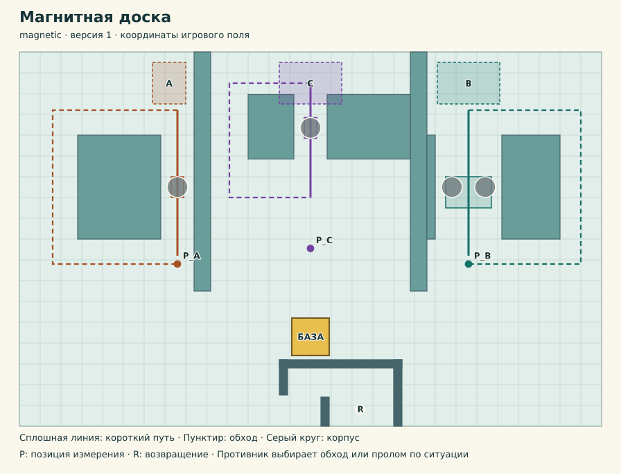
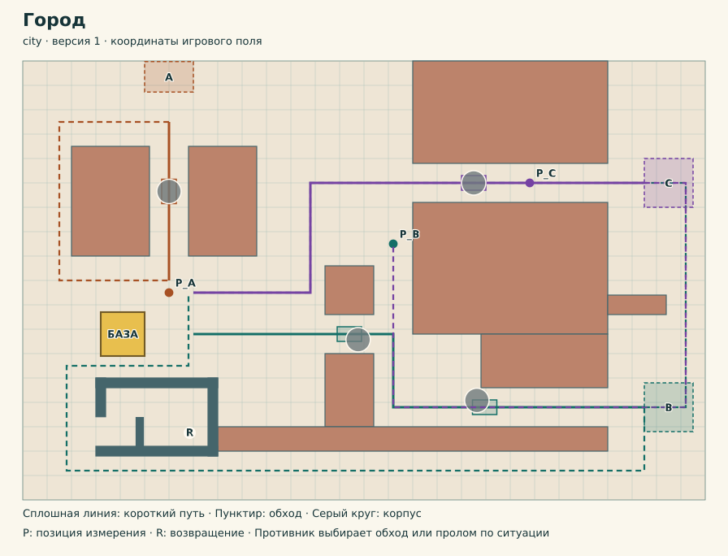

# Техническая проверка двух карт

Исторический отчёт сборки `prototype-06-two-maps-1`. Для текущих исправлений ИИ и расписания см. [повторную проверку](ai-firing-self-defense-verification.md). Числа и браузерные результаты ниже относятся к исходной сборке.

Проверены карты `magnetic` и `city` версии 1 в сборке `prototype-06-two-maps-1`. SHA-256 проверенного `index.html` — `ffdd60f1155686d14cedc57c49157eef076a530d1e8f16f196c1967d9c33a83c`. Общие боевые правила из #33 вошли коммитом `16358105cdaf3a94b64122dc87769a451ef3b0d9`.

## Расписание

`node tools/calibrate-maps.cjs index.html /tmp/map-calibration.json` загружает ядро из HTML и сверяет пересчитанные старты с данными сборки. На обеих картах измерены 16 одиночных пакетов и восемь совместных волн. Все выпуски и первые попадания зарегистрированы. В первом проходе по каждой очереди игра сохранила порядок техники и минимальный интервал 150 тиков, включая случаи ожидания спавна. В отчёте есть координаты, команды перебежек, первая попытка калибровки, поправки и конечные окна. [Измерения кампаний](evidence/map-campaign-calibration.json)

Перебежки игрока в тиках при скорости 4:

| Карта | C → B | B → C | A → C | C → A | A → B | B → A |
| --- | ---: | ---: | ---: | ---: | ---: | ---: |
| Магнитная доска | 185 | 185 | 167 | 167 | 270 | — |
| Город | 122 | — | 290 | 290 | 168 | 168 |

Для измерения подходов игрок исключён из целей и коллизий, возрождение отключено. База сохраняет 240 HP, попадания и полёт снарядов происходят штатно. В таблице `S` — плановый старт группы, `F` — её первый фактически выпущенный снаряд с открытой линией по базе. Обе величины даны в тиках по 1/60 с.

| Волна | Магнитная доска, S / F | Город, S / F |
| --- | --- | --- |
| 1 | A 0 / 225 | A 0 / 87 |
| 2 | A 0 / 374 | A 0 / 168 |
| 3 | C 0 / 124 | C 0 / 388 |
| 4 | C 0 / 224, B 948 / 1173 | C 0 / 626, B 1137 / 1512 |
| 5 | B 0 / 390, C 1216 / 1339 | B 0 / 610, C 10 / 397 |
| 6 | A 0 / 225, C 303 / 526, B 996 / 1371 | A 964 / 1050, C 0 / 626, B 1026 / 1711 |
| 7 | B 0 / 226, C 322 / 545, A 455 / 832 | B 0 / 376, C 463 / 1088, A 511 / 678 |
| 8 | A 0 / 530, B 334 / 709, C 542 / 832 | A 789 / 992, B 503 / 1112, C 0 / 803 |

В прототипе геометрии тяжёлый C на магнитной доске останавливался для стрельбы в горловине, и пятый танк одиночного пакета финала оставался в очереди на отметке 120 с. Перенос горловины к верхнему краю оставил место для разъезда за её выходом. В первоначальном городе C занимал общий выход B, и в совместном финале у B не было выстрела за 120 с. Отдельный выход B к юго-восточной стороне базы оставил доступной перекрёстную сеть обходов через C. Перенос северного спавна дал место очереди A. Обе доработки повторно проверены на конечной геометрии.

## Контроль корпусов

`node tools/verify-maps.cjs index.html /tmp/map-controls.json` воспроизводит пакеты A из В2, C из В4 и B из В5. Для каждой сравниваемой пары игрок жив, без модуля, находится в защищённой точке и получает одинаковую команду ожидания. Вставленные корпуса помечены как диагностические. Порог задержки составляет 90 тиков, или 1,5 с.

| Карта | A, без / с корпусом | C, без / с корпусом | B, без / с парой |
| --- | ---: | ---: | ---: |
| Магнитная доска | 374 / 609 | 224 / 361 | 390 / 688 |
| Город | 168 / 284 | 626 / 885 | 610 / 896 |

В каждой сцене проверены средний корпус с 60 и 20 HP, тяжёлый со 120 HP, пустой проход, разбор, разрушение штатным снарядом и истечение срока. В B проверены оба одиночных положения и пара. После каждого из трёх способов удаления времена первых выстрелов в соответствующих сценах совпали с чистым проходом. На магнитной доске одиночный корпус B дал задержку до 7 тиков, пара — 298. В городе оценка первого врага для пролома выросла с 15,75 до 17,93 с с добавлением дальнего корпуса. Из фактической точки первого выстрела по ближнему корпусу дальний находился вне дальности; в контрольном прогоне пары противник выбрал обход. [Сводка контрольных сцен](evidence/map-hull-controls.json)

У магнитной доски занятая основная точка возврата даёт две проверенные запасные позиции. Регрессионная сцена с выстрелом лёгкого из западного проезда сохраняет 60 HP игрока на запасной позиции. При заполнении всех допустимых центров игра ждёт. В городе внутренний экран закрывает выход с запада от прямого огня, сохраняя проход.

## Корпуса, полученные штатным вводом

| Карта | В1 A, центр и тик гибели среднего | В3 C, центр и тик гибели среднего |
| --- | --- | --- |
| Магнитная доска | (7,524; 6,476), 325 | (14,010; 3,933), 235 |
| Город | (5,881; 5,380), 346 | (18,482; 5,094), 432 |

Оба прогона В1 начаты новой попыткой и закончены в подготовке В2 с полным корпусом в полезной области и базой 240 HP. В обоих случаях в момент гибели среднего последний лёгкий ещё не вышел. Прогоны В3 воспроизведены с новой попытки по журналу обычных команд, затем из подготовки применены новые команды. До выпуска всей оставшейся группы дальность, прицел и огонь позволили подбить средний в полезной области. Эффект этих мест на В2 и В4 измерен парными сценами выше.

В контрольных воспроизведениях из записанных подготовок В7 обе карты дошли до старта В8 с двумя корпусами именно из B В7. В городе сохранилось 40 HP среднего и 120 HP тяжёлого, на магнитной доске — 60 и 120 HP. Ранее полученные корпуса на B потрачены штатными операциями подготовки, прежде чем получить новую пару. Это отдельные воспроизведения одной волны из состоявшейся попытки. [Воспроизведения получения пары](evidence/map-b-acquisition.json)

## Подготовка и полные прогоны

Варианты В2 разобраны из реально записанных состояний с одним полезным средним. Сохранение оставляет корпус, двигатель и ствол дают соответствующий модуль и расходуют корпус, ремонт расходует корпус при текущем дефиците HP. В обеих записанных подготовках В2 база уже имеет 240 HP: действие законно разбирает корпус с приростом 0 HP, поэтому эти две ветки не доказывают восстановление повреждённой базы. В В5 проверены сохранение тяжёлого из C В4 и отдельного среднего, извлечение брони и укрепление тяжёлого с расходом другого корпуса. Обе карты дали записанные снимки, где эти действия законны.

После каждой операции В2 и В5 бой запущен из того же записанного снимка с одинаковой командой ожидания. В В2 сохранение корпуса отодвинуло первый выстрел с 374 до 607 тиков на магнитной доске и со 168 до 483 в городе. Первые попадания сдвинулись с 407 до 642 и со 197 до 512 тиков соответственно. В В5 времена первого выстрела для сохранения, брони и укрепления составили 617/617/390 тиков на магнитной доске и 912/403/912 в городе. Расход донора может открыть другой путь, поэтому укрепление не обязательно задерживает всю атаку. В В7 и В8 такой же бой выполнен для всех доступных записанных веток. Поражения при бездействии и судьба корпусов сохранены в отчёте.

В В7 и В8 верхний предел календаря составляет четыре и пять корпусов. В зарегистрированных обычных подготовках магнитной доски достигнуты оба максимума по количеству. В городе в обычной подготовке В7 наблюдалось три корпуса, а в В8 — пять. Отдельные сценарии с искусственным максимумом используют заданные типы и происхождение корпусов из календаря. Для каждой карты и волны сравниваются максимум, расход одного полезного корпуса, естественное истечение срока у более старого корпуса и отсутствие корпусов. Каждая ветка использует одинаковый ввод ожидания в бою и штатную уязвимость базы. В контрольных сценах без корпусов первая потеря HP началась на тиках 406 и 619 на магнитной доске и 411 и 981 в городе, для В7 и В8 соответственно. Все четыре сцены без оборонительного ввода закончились поражением. [Ветки подготовки и поздних волн](evidence/map-hull-controls.json)

Четыре отдельные попытки начаты с новой игры и завершены через обычные команды движения, огня и подготовки. Во всех 66 врагов побеждены за восемь волн без гибели игрока. Двигатель в таблице обозначает попытку без ствола.

| Карта | Модуль | База в конце, HP | Игрок в конце, HP |
| --- | --- | ---: | ---: |
| Магнитная доска | двигатель | 92 | 60 |
| Магнитная доска | ствол | 20 | 60 |
| Город | двигатель | 199 | 36 |
| Город | ствол | 139 | 60 |

Использован `tools/verify-maps-campaign.cjs`. Полные измерительные отчёты, последовательности команд, наблюдения и журналы попыток сохранены в материалах #34. Человеческое восприятие темпа, читаемость предупреждений и повторяемость размещений проверяются в #14.

## Схемы и воспроизведение

Схемы строятся из фактических `MAP_CONFIGS` командой `node tools/render-map-diagrams.cjs`. Они показывают доступные ветки и позиции; решение противника учитывает текущие корпуса и соседей.





Обычные полные попытки воспроизводятся независимо от диагностических контролей:

```bash
node tools/verify-maps-campaign.cjs index.html magnetic engine /tmp/map-campaigns/magnetic-engine
node tools/verify-maps-campaign.cjs index.html magnetic barrel /tmp/map-campaigns/magnetic-barrel
node tools/verify-maps-campaign.cjs index.html city engine /tmp/map-campaigns/city-engine
node tools/verify-maps-campaign.cjs index.html city barrel /tmp/map-campaigns/city-barrel
```

Каждая команда требует нового каталога и сохраняет `commands.ndjson`, `attempt.json`, наблюдения, результат и состояния подготовки до расходов. Исходный HTML проверяется по SHA-256; [сводка четырёх попыток](evidence/map-campaigns.json) содержит также контрольные суммы журналов. Ввод проверяющего бота не записывает HP, корпуса, позиции или фазу напрямую. Его результаты показывают техническую возможность прохождения; длительность автоматической попытки не подтверждает человеческий ориентир 8–12 минут.

Получение среднего в полезной области В1/В3 воспроизводится штатным вводом:

```bash
node tools/verify-map-learning.cjs index.html magnetic 1 /tmp/map-learning-magnetic-1
node tools/verify-map-learning.cjs index.html city 1 /tmp/map-learning-city-1
node tools/verify-map-learning.cjs index.html magnetic 3 /tmp/map-learning-magnetic-3 /tmp/map-campaigns/magnetic-engine/commands.ndjson
node tools/verify-map-learning.cjs index.html city 3 /tmp/map-learning-city-3 /tmp/map-campaigns/city-engine/commands.ndjson
```

Для В3 сначала воспроизводятся обычные команды В1/В2 от новой игры, затем меняется только последующий ввод. Подмена состояния не используется.

Получение пары B проверяется отдельным восстановлением записанной подготовки В7:

```bash
node tools/verify-map-b-acquisition.cjs index.html /tmp/map-campaigns/magnetic-barrel/prep-7.json /tmp/map-b-magnetic
node tools/verify-map-b-acquisition.cjs index.html /tmp/map-campaigns/city-engine/prep-7.json /tmp/map-b-city
```

После явно отмеченного восстановления все движения, выстрелы и расходы выполняются штатно. Все группы В7 сохранены. Проверяется фактический старт В8, происхождение двух корпусов из B В7, их области и прочность. Несовпадение SHA исходного состояния и HTML отклоняется.

## Проверка браузера и автономного файла

```bash
node tools/verify-map-browser.cjs index.html /tmp/map-browser /tmp/map-campaigns
```

Для команды нужен установленный `google-chrome`. Проверка в Chrome использует настоящие события клавиатуры и мыши. Подтверждены выбор обеих карт и миниатюры, сводка восьми волн, перемещение, Enter, стрельба, справка, сброс новой попытки и экспорт JSON. HTML скачан через локальный HTTP-сервер и побайтно сравнен с исходным. После остановки сервера обе карты открыты из скачанного файла; HTTP-запросов не было, исключений JavaScript не зарегистрировано.

Отдельно обозначенные диагностические HTML проверяют отсчёт, ожидание занятого входа и снятие сигнала после первого фактического выпуска. В восстановленных штатных подготовках В2 мышью выбран ствол, расход корпуса отражён в журнале, отмена вернула корпус и модуль. Сцены размещения и гибели открыты на обеих картах; счётчик правильно показывает две контрольные волны. Эти искусственные проверки интерфейса не включены в доказательства полного прохождения.

Автоматические проверки: `npm test`. На момент подготовки отчёта полный набор прошёл 161/161; итоговая CI проверяет опубликованную ревизию отдельно. Ограничения: измерительные программы фиксируют пики времени шага, но не доказывают стабильные 60 кадров/с на любом устройстве. Схемы и интерфейс просмотрены в настольном окне Chrome.

## Контрольные сцены для #14

```bash
node tools/playtest-scene.cjs placement /tmp/magnetic-placement.html magnetic
node tools/playtest-scene.cjs death /tmp/magnetic-death.html magnetic
node tools/playtest-scene.cjs placement /tmp/city-placement.html city
node tools/playtest-scene.cjs death /tmp/city-death.html city
```

`placement`: подготовка к первой из двух контрольных волн, база 240 HP, игрок 60 HP без модуля в P_A, корпусов нет. Сначала идёт тяжёлый A, затем средний A и лёгкий C; следующая волна снова использует A. Варианты — раннее уничтожение и заранее выбранное место корпуса.

`death`: та же карта и сохранённая штатная ниша; пауза после настоящего выстрела тяжёлого в игрока. База имеет 240 HP, игрок диагностически установлен на 20 HP, модуль отсутствует. После продолжения работают обычное попадание и возвращение через 4 с; отложенные враги оставляют бой активным. Варианты — выживание и намеренная гибель.

Файлы являются искусственными одинаковыми стартами для сравнений. В конфигурации журнала есть `controlScene.diagnostic`, добавлено событие `control_scene`; они не выдаются за обычные кампании. Для каждой пары один освоившийся тестировщик заранее выбирает карту и выполняет порядок A, B, B, A. Наличие двух вариантов файлов не удваивает обязательный объём исследования.

Для свободной серии подготовлен комплект #14: пять участников, по две попытки каждому всего, обе попытки человека на одной назначенной карте; обе карты представлены в серии. В комплект входят этот HTML, четыре контрольных HTML, идентификатор сборки и контрольные суммы, инструкция ведущему, бланк участника и форма сводки. Сессии и предварительная проверка неподвижных позиций человеком ещё не проведены. #14 и общий вывод о гипотезе игры остаются открытыми.
