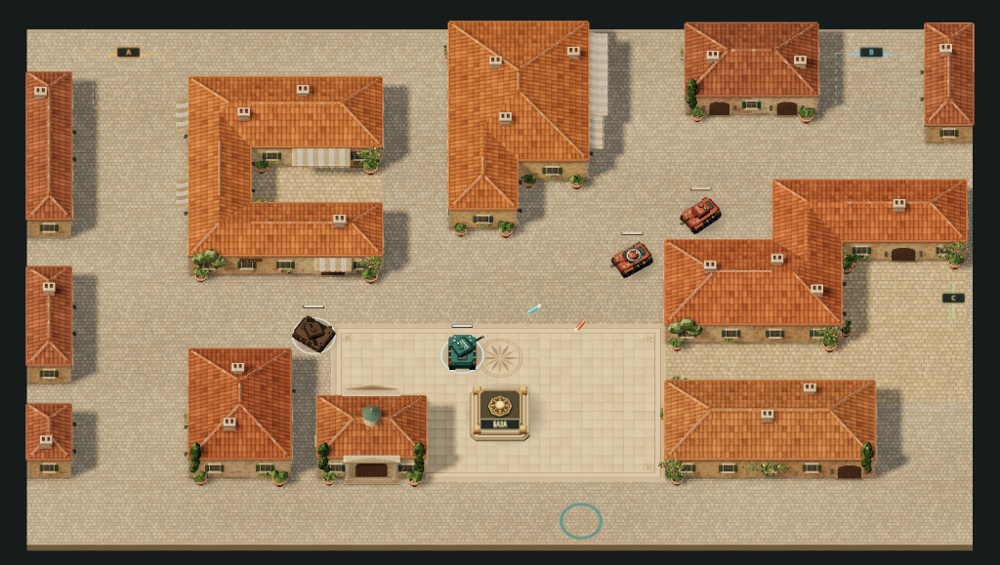

# Тёплый город 3D

Самостоятельная 3D-версия Tanks for the Cover: средиземноморский город, тёплый свет, черепичные крыши, детальные фасады и бронетехника. Сохраняет восемь волн, корпуса, модули, ремонт и отмену подготовки. Основной 2D-прототип находится в корневом `index.html`; эта версия использует собственную карту.

## Играть

Скачайте [tanks-warm-town-3d.html](tanks-warm-town-3d.html) кнопкой **Download raw file** в GitHub и откройте его в настольном браузере. Нужны WebGL 2, клавиатура и мышь. Движок, Three.js, текстуры и звук включены в один HTML: сервер, установка зависимостей и интернет для игры не требуются. Под `file://` файл можно копировать средствами ОС; ссылка скачивания в игре доступна при открытии через HTTP(S).

- **WASD / стрелки** — движение; **мышь** — прицел; **ЛКМ** — огонь или выбор корпуса при подготовке.
- **Enter** — начать волну; **Esc** — пауза; **Ctrl+Z** — отменить действия подготовки.
- База находится на площади; кольцо на нижней улице отмечает место возвращения танка. Входы A/B/C обозначены пунктиром.
- Средние и тяжёлые противники оставляют корпуса вне зон появления. Между волнами выберите корпус, чтобы отремонтировать базу, установить модуль или укрепить другой корпус.



[Общий вид](docs/images/city-1366x900.png) · [Проверки и ограничения](docs/verification.md)

## Сборка и проверки

Из корня репозитория, Node.js 20+:

```sh
npm run build:3d
npm run test:3d
npm test
```

Сборка работает без сети. `npm test` включает проверку совпадения пересобранного HTML с версией в Git, воспроизводимость сборки, симуляцию 3D-карты, создание blockout из чистой копии и регрессию геометрии навеса. Если изменили исходники, перед тестами выполните `npm run build:3d` и включите обновлённый HTML в коммит.

Для браузерной проверки установите Chrome, затем выполните из корня репозитория:

```sh
npm run test:3d:browser
npm run test:3d:browser -- --layout-only --no-float-cache
npm run test:3d:browser -- --recovery-only
```

`TOWN_CHROME` задаёт путь к Chrome. Проверка открывает HTML через `file://` с отключённой сетью и управляет игрой обычным вводом клавиатуры/мыши. Результаты сохраняются в игнорируемом `evidence/`. Режим `--no-float-cache` отключает необязательные float-расширения до загрузки игры и проверяет пиксели города в запасном режиме.

Для упрощённой геометрии: `node experiments/warm-town-3d/build.cjs --blockout`. Результат — `experiments/warm-town-3d/evidence/blockout.html`.

## Исходники

- `src/game.html` — интерфейс и игровая симуляция; `src/layout.json` — карта, двери, входы, пути и точка возвращения.
- `src/town.mjs` — геометрия города и процедурные материалы.
- `src/units.js`, `src/view.js`, `src/ui.css` — танки, свет, камера, прицел, эффекты и оформление.
- `build.cjs` — сборка автономного HTML; `tools/` — проверки и сборка библиотеки.
- `vendor/` — Three.js 0.187.0 и [лицензия MIT](vendor/LICENSE). Исходные `vendor/build/three.module.js` и `three.core.js` взяты из [npm-архива three 0.187.0](https://registry.npmjs.org/three/-/three-0.187.0.tgz). Готовый `three-r187.js` включён в Git, поэтому обычной сборке npm-пакеты не нужны. Для пересборки самой библиотеки используйте команду в `tools/bundle-three.mjs` с esbuild 0.19.12.
